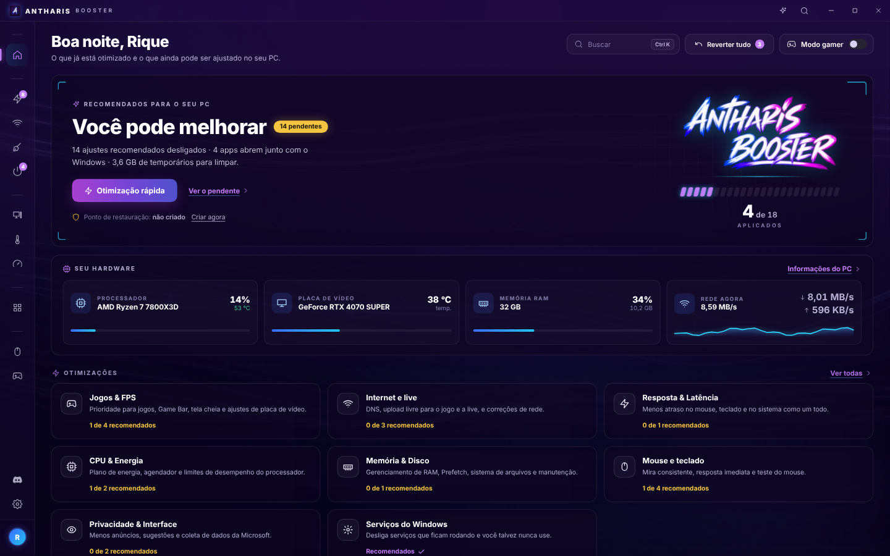
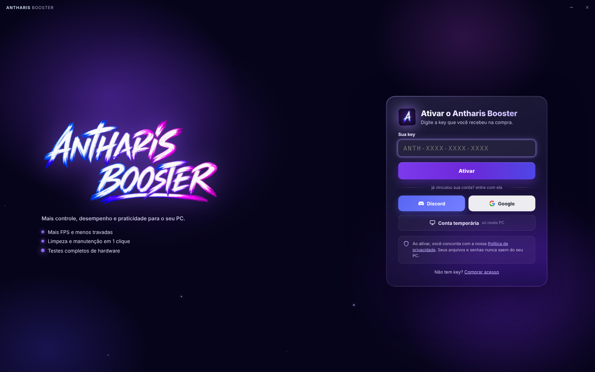

Otimizador de PC da <b>Antharis Store</b>. Deixe o Windows pronto para jogar, limpe o que não serve, controle processador e memória e acompanhe as temperaturas do seu hardware em tempo real, tudo em uma interface simples.

  

Windows 10 / 11 (64 bits) · versão mais recente · precisa de uma key de acesso · <a href="https://antharisstore.com/">comprar acesso</a>

## O que ele faz

- **Otimização rápida:** aplica de uma vez os ajustes recomendados para o seu PC.
- **Jogos e FPS:** modo gamer, prioridade para jogos, tela cheia e ajustes da placa de vídeo.
- **Mouse e teclado:** ajustes de resposta e teste de polling rate, estabilidade e atraso.
- **Internet:** DNS, correções de rede e teste de velocidade.
- **Processador e memória:** desbloqueio de núcleos, limite de velocidade e limpeza automática da RAM.
- **Limpeza:** arquivos temporários, cache de apps e lixo do Windows.
- **Medidor de FPS:** contador de FPS por cima do jogo (com atalho para ligar e desligar) e comparação de antes e depois das otimizações.
- **Hardware:** informações de cada peça, temperaturas em tempo real, testes de estresse e saúde da bateria.
- **Tudo reversível:** cada ajuste pode ser desfeito, e há o botão **Reverter tudo**.

## Como instalar

1. Clique em **Baixar Antharis Booster** acima. O download começa na hora.
2. Abra o arquivo **AntharisBooster-Setup.exe** e siga a instalação.
3. Se aparecer **"O Windows protegeu o computador"**, clique em **Mais informações** → **Executar assim mesmo**. Isso acontece só na primeira instalação.
4. Abra o **Antharis Booster** pelo atalho na área de trabalho e aceite o aviso de administrador.

## Ativando sua key

1. Na primeira vez, o app pede a **key** que você recebeu na compra (formato `ANTH-XXXX-XXXX-XXXX`).
2. Digite a key e clique em **Ativar**.
3. Em seguida, **vincule uma conta** (recomendado):
   - **Discord** ou **Google**: ao trocar ou formatar o PC, é só entrar com a conta, sem digitar a key de novo.
   - **Conta temporária**: fica guardada só neste PC. Se formatar ou trocar de PC, use a key.

A key continua ativada nas próximas atualizações. Para sair, vá em **Configurações → Preferências → Sair**.

> A licença é conferida a cada 2 minutos. Quando a key vence, o acesso fecha na hora. Sem internet, o app continua funcionando por até 1 hora.

## Atualizações

Quando sair uma versão nova, o próprio app baixa e instala sozinho. Você não precisa voltar aqui. Para desligar isso, vá em **Configurações → Preferências → Atualizar automaticamente**.

## Privacidade

Para validar a licença, o app envia **só dados técnicos** do PC: hardware, configurações do app e temperaturas. Ele nunca envia arquivos, senhas ou o que você faz no PC. Leia a [Política de Privacidade](https://riqueroder.github.io/antharis-booster-download/privacidade/).

---

Feito por Rique · <a href="https://antharisstore.com/">antharisstore.com</a> · <a href="https://riqueroder.github.io/antharis-booster-download/">site do Antharis Booster</a>

